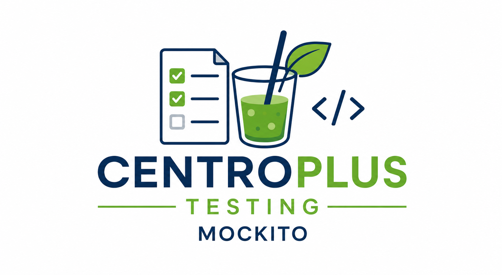

# Mockito con Java y Maven

<div align="center" width="200">
     
</div>

## Introducción

Mockito es una librería de testing para proyectos Java.

Permite crear objetos simulados:

- mocks
- stubs
- verificaciones
- simulación de dependencias

Se utiliza junto con:

- JUnit 5
- Maven
- Java 17

---

## Objetivos

Implementar:

```text
✔ pruebas unitarias aisladas
✔ simulación de dependencias
✔ verificación de llamadas
✔ validación de lógica de negocio
```

---

## Tecnologías utilizadas

### Java 17

Versión recomendada para el proyecto.

---

### Maven

Gestión de dependencias y ejecución de tests.

---

### JUnit 5

Framework principal de testing.

---

### Mockito

Librería para crear mocks y probar clases de forma aislada.

---

## Dependencia JUnit 5

Añadir dentro de:

```xml
<dependencies>
```

```xml
<dependency>
    <groupId>org.junit.jupiter</groupId>
    <artifactId>junit-jupiter</artifactId>
    <version>5.10.2</version>
    <scope>test</scope>
</dependency>
```

> Añade una propiedad `<junit.version>5.10.2</junit.version>` y la utilizas `${junit.version}`

---

## Dependencia Mockito

Añadir dentro de:

```xml
<dependencies>
```

```xml
<dependency>
    <groupId>org.mockito</groupId>
    <artifactId>mockito-core</artifactId>
    <version>5.12.0</version>
    <scope>test</scope>
</dependency>
```

> Crea una propiedad para la version `5.12.0`

---

## Dependencia Mockito JUnit Jupiter

Necesaria para usar Mockito con JUnit 5.

```xml
<dependency>
    <groupId>org.mockito</groupId>
    <artifactId>mockito-junit-jupiter</artifactId>
    <version>5.12.0</version>
    <scope>test</scope>
</dependency>
```

> Puedes reutilizar la propiedad `${mockito.version}`

---

## Configuración Java 17

Añadir dentro de:

```xml
<build>
    <plugins>
```

```xml
<plugin>
    <groupId>org.apache.maven.plugins</groupId>
    <artifactId>maven-compiler-plugin</artifactId>
    <version>3.11.0</version>

    <configuration>
        <source>17</source>
        <target>17</target>
    </configuration>
</plugin>
```

> Crea una propiedad para la version `3.11.0`

---

## Configuración Maven Surefire

Necesario para ejecutar JUnit 5.

```xml
<plugin>
    <groupId>org.apache.maven.plugins</groupId>
    <artifactId>maven-surefire-plugin</artifactId>
    <version>3.2.5</version>
</plugin>
```

> Crea una propiedad para la version `3.2.5`

---

## Configuración completa recomendada

```xml
<properties>
    <java.version>17</java.version>
    <junit.version>5.10.2</junit.version>
    <mockito.version>5.12.0</mockito.version>
    <maven.compiler.version>3.11.0</maven.compiler.version>
    <maven.surefire.version>3.2.5</maven.surefire.version>
</properties>

<dependencies>

    <dependency>
        <groupId>org.junit.jupiter</groupId>
        <artifactId>junit-jupiter</artifactId>
        <version>${junit.version}</version>
        <scope>test</scope>
    </dependency>

    <dependency>
        <groupId>org.mockito</groupId>
        <artifactId>mockito-core</artifactId>
        <version>${mockito.version}</version>
        <scope>test</scope>
    </dependency>

    <dependency>
        <groupId>org.mockito</groupId>
        <artifactId>mockito-junit-jupiter</artifactId>
        <version>${mockito.version}</version>
        <scope>test</scope>
    </dependency>

</dependencies>

<build>

    <plugins>

        <plugin>
            <groupId>org.apache.maven.plugins</groupId>
            <artifactId>maven-compiler-plugin</artifactId>
            <version>${maven.compiler.version}</version>

            <configuration>
                <source>${java.version}</source>
                <target>${java.version}</target>
            </configuration>
        </plugin>

        <plugin>
            <groupId>org.apache.maven.plugins</groupId>
            <artifactId>maven-surefire-plugin</artifactId>
            <version>${maven.surefire.version}</version>
        </plugin>

    </plugins>

</build>
```

> Recuerda escapar las propiedades.

---

## Ejecutar tests

## Maven

```bash
mvn clean test
```

---

## Qué es un mock

Un mock es un objeto falso que simula el comportamiento de una dependencia real.

Permite probar una clase sin depender de:

- base de datos
- ficheros
- API externa
- repositorios reales
- servicios externos

---

## Cuándo usar Mockito

Mockito se utiliza principalmente en pruebas unitarias.

```text
✔ servicios
✔ lógica de negocio
✔ validaciones
✔ errores controlados
✔ dependencias externas simuladas
```

---

## Cuándo no usar Mockito

No siempre es necesario usar mocks.

```text
✘ clases simples sin dependencias
✘ getters y setters básicos
✘ constructores simples
✘ pruebas de integración completas
```

---

## Anotaciones principales

### @Mock

Crea un objeto simulado.

```java
@Mock
private ActividadRepository actividadRepository;
```

---

### @InjectMocks

Crea la clase que se quiere probar e inyecta los mocks necesarios.

```java
@InjectMocks
private ActividadService actividadService;
```

---

### @ExtendWith(MockitoExtension.class)

Activa Mockito en JUnit 5.

```java
@ExtendWith(MockitoExtension.class)
class ActividadServiceTest {
}
```

---

## Ejemplo de clase a probar

```java
public class ActividadService {

    private final ActividadRepository actividadRepository;

    public ActividadService(ActividadRepository actividadRepository) {
        this.actividadRepository = actividadRepository;
    }

    public Actividad findById(int id) {
        return actividadRepository.findById(id);
    }
}
```

---

## Ejemplo de test con Mockito

```java
import static org.junit.jupiter.api.Assertions.assertEquals;
import static org.mockito.Mockito.when;

import org.junit.jupiter.api.Test;
import org.junit.jupiter.api.extension.ExtendWith;
import org.mockito.InjectMocks;
import org.mockito.Mock;
import org.mockito.junit.jupiter.MockitoExtension;

@ExtendWith(MockitoExtension.class)
class ActividadServiceTest {

    @Mock
    private ActividadRepository actividadRepository;

    @InjectMocks
    private ActividadService actividadService;

    @Test
    void findByIdTest() {
        Actividad actividad = new Actividad(1, "Programación");

        when(actividadRepository.findById(1)).thenReturn(actividad);

        Actividad resultado = actividadService.findById(1);

        assertEquals(actividad, resultado);
    }
}
```

---

## Stubbing

El stubbing permite definir qué debe devolver un mock.

```java
when(actividadRepository.findById(1)).thenReturn(actividad);
```

---

## Verificación de llamadas

Mockito permite comprobar si un método fue ejecutado.

```java
verify(actividadRepository).findById(1);
```

---

## Verificación del número de llamadas

```java
verify(actividadRepository, times(1)).findById(1);
```

---

## Ejemplo completo con verify

```java
import static org.junit.jupiter.api.Assertions.assertEquals;
import static org.mockito.Mockito.times;
import static org.mockito.Mockito.verify;
import static org.mockito.Mockito.when;

import org.junit.jupiter.api.Test;
import org.junit.jupiter.api.extension.ExtendWith;
import org.mockito.InjectMocks;
import org.mockito.Mock;
import org.mockito.junit.jupiter.MockitoExtension;

@ExtendWith(MockitoExtension.class)
class ActividadServiceTest {

    @Mock
    private ActividadRepository actividadRepository;

    @InjectMocks
    private ActividadService actividadService;

    @Test
    void findByIdTest() {
        Actividad actividad = new Actividad(1, "Programación");

        when(actividadRepository.findById(1)).thenReturn(actividad);

        Actividad resultado = actividadService.findById(1);

        assertEquals(actividad, resultado);
        verify(actividadRepository, times(1)).findById(1);
    }
}
```

---

## Simular excepciones

Mockito permite simular errores controlados.

```java
when(actividadRepository.findById(99))
    .thenThrow(new RuntimeException("Actividad no encontrada"));
```

---

## Test de excepción

```java
import static org.junit.jupiter.api.Assertions.assertThrows;
import static org.mockito.Mockito.when;

@Test
void findByIdNotFoundTest() {
    when(actividadRepository.findById(99))
        .thenThrow(new RuntimeException("Actividad no encontrada"));

    assertThrows(RuntimeException.class, () -> {
        actividadService.findById(99);
    });
}
```

---

## Argument matchers

Permiten verificar o simular valores flexibles.

```java
when(actividadRepository.findById(anyInt())).thenReturn(actividad);
```

Otros matchers comunes:

```text
✔ any()
✔ anyInt()
✔ anyString()
✔ eq(valor)
```

---

## Estructura recomendada

```text
src
├── main
│   └── java
│
└── test
    └── java
        └── es
            └── ies
                └── puerto
                    ├── models
                    ├── repositories
                    └── services
```

---

## Qué debe probarse con Mockito

### Services

```text
✔ lógica de negocio
✔ llamadas a repositorios
✔ validaciones
✔ control de errores
✔ reglas funcionales
```

---

### Repositories

```text
✔ comportamiento simulado desde servicios
✔ respuestas esperadas
✔ errores esperados
```

---

### Controllers

```text
✔ solo si se aíslan dependencias
✔ validación de llamadas a servicios
✔ respuestas esperadas
```

---

## Qué no debe probarse con Mockito inicialmente

```text
✘ JavaFX Controllers visuales
✘ FXML
✘ componentes gráficos
✘ conexión real a base de datos
```

porque normalmente requieren:

- testing funcional
- testing de integración
- TestFX

---

## Buenas prácticas

```text
✔ probar una sola responsabilidad por test
✔ usar nombres claros en los métodos de test
✔ preparar datos sencillos
✔ verificar resultados importantes
✔ verificar llamadas solo cuando aporte valor
✔ no abusar de los mocks
```

---

## Herramientas recomendadas

### Fase inicial

```text
JUnit 5
+
Mockito
```

---

### Fase avanzada

```text
Mockito
+
JaCoCo
+
TestFX
+
SonarQube
```

---

## Beneficios de Mockito

```text
✔ permite pruebas unitarias aisladas
✔ evita dependencias reales innecesarias
✔ mejora la velocidad de los tests
✔ facilita probar errores
✔ ayuda a validar lógica de negocio
✔ reduce la complejidad de los tests
```

<div align="center" width="400">
     
</div>

---

## Conclusión

Mockito es una herramienta fundamental para realizar pruebas unitarias en proyectos Java.

Permite:

- aislar clases
- simular dependencias
- verificar llamadas
- probar errores
- mejorar la calidad del código
- mantener tests rápidos y claros

</div>
